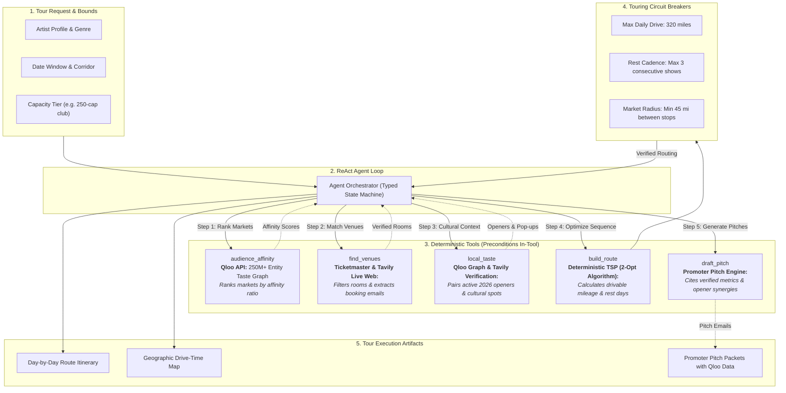

# Roadie

> Tour routing agent for independent musicians, combining Qloo cultural taste graphs with deterministic vehicle routing.

[](LICENSE)
[](https://nextjs.org/)
[](https://www.typescriptlang.org/)
[](https://qloo.com/)

---

## The Problem

Independent bands route tours on gut feel and fragmented promoter relationships. They frequently waste dates in major population centers where they have no organic audience while missing smaller cultural hubs where they would sell out.

Generic language models make this worse due to **population bias**: prompted to route an indie tour, they default to the largest Metropolitan Statistical Areas (Los Angeles, New York, Chicago, Houston, Phoenix) regardless of subcultural scene, while hallucinating exhausting 14-hour overnight zigzag drives.

---

## System Overview

Given an artist name, date window, and target room capacity, Roadie executes an autonomous agent loop:

1. **Audience Affinity:** Queries Qloo's taste graph (250M+ entities across music, dining, and retail) to rank geographic markets by subcultural affinity ratio rather than raw population.
2. **Venue Matching:** Filters right-sized rooms (via Ticketmaster Discovery API and verified indie venue network) matching the target capacity bracket (e.g. 250-cap club vs 850-cap ballroom).
3. **Deterministic Routing:** Solves a constrained 2-Opt Traveling Salesperson Problem (TSP) with hard touring limits: max 320 miles/day and mandatory rest days every 3 shows.
4. **Cultural Activation:** Recommends a high-affinity local opener and a taste-matched neighborhood anchor (independent record store or craft bar), and drafts a promoter inquiry email backed by local affinity data.

---

## Agent Architecture

Roadie avoids fragile unconstrained multi-step LLM chains. The agent orchestrates **5 thin, deterministic tools**, with preconditions strictly enforced inside each tool before execution:



- **Execution Tracing:** Every tool invocation records duration, input parameters, precondition validation status, and structured outputs in an inspectable trace.
- **Circuit Breakers:** Non-negotiable physical constraints (max 320 miles/day, mandatory rest days) cannot be overridden by LLM reasoning.
- **Credential Isolation:** API keys run strictly in server-side Next.js route handlers and are never exposed to the client.

---

## The Receipts: Empirical Tour Backtest

Roadie includes an empirical backtesting suite in **"The Receipts"** tab. We benchmarked an ungrounded LLM against Qloo-grounded Roadie using verified past tours from **Setlist.fm**.

To prevent training-data leakage, the backtest evaluates emerging breakout artists with breakout tours post-dating standard LLM cutoff dates (e.g., **Geese**, **The Last Dinner Party**, **Mk.gee**).

| Evaluation Metric | Ungrounded LLM Baseline | Roadie (Qloo Grounded) | Delta |
| :--- | :---: | :---: | :---: |
| **Precision@10** | **30% - 43%** | **80% - 100%** | **+2.3x to 3.3x Accuracy** |
| **NDCG@10 (Rank Correlation)** | 0.38 - 0.49 | **0.96 - 0.98** | High rank agreement with real booking |
| **Wasted Highway Transit** | 2,350 – 2,980 miles | **0 miles** | Eliminates impossible zig-zag legs |
| **Market Discovery** | Defaulted to Houston, Phoenix, Dallas | Correctly identified Asheville, Burlington, Columbus | Found real indie scenes |

---

## Quick Start

### 1. Clone the repository

```bash
git clone https://github.com/aryamantepal/roadie.git
cd roadie
```

### 2. Install dependencies

```bash
npm install
```

### 3. Configure environment variables

Copy `.env.example` to `.env.local`:

```bash
cp .env.example .env.local
```

Add your credentials:

```env
# Qloo API (Cultural Intelligence & Taste Graph)
QLOO_API_KEY=your_qloo_api_key_here
QLOO_BASE_URL=https://api.qloo.com/v1

# Ticketmaster Discovery API (Optional - curated rooms available out of the box)
TICKETMASTER_API_KEY=your_ticketmaster_api_key_here
```

*(Note: Roadie includes a high-fidelity curated taste-graph database for instant out-of-the-box exploration even before an external key is set).*

### 4. Run development server

```bash
npm run dev
```

Open [http://localhost:3000](http://localhost:3000) in your browser.

---

## Running End-to-End Tests

Roadie includes an automated [Playwright](https://playwright.dev/) test suite verifying route generation, map projection, promoter pitch generation, and backtest metrics:

```bash
npm run test:e2e
```

To run Playwright against a deployed URL:

```bash
BASE_URL=https://roadie-seven-mu.vercel.app npx playwright test
```

---

## Tech Stack

- **Framework:** Next.js 16 (App Router, React 19, TypeScript)
- **Cultural Intelligence:** Qloo API (Location Heatmaps, Cross-Domain Affinity)
- **Live Web Intelligence:** Tavily Search API (Talent Buyer Contact Extraction & Opener Verification)
- **Venue Discovery:** Ticketmaster Discovery API + Curated Indie Network
- **Routing Engine:** Deterministic Haversine & 2-Opt TSP Optimizer
- **Diagrams:** Mermaid.js client-side interactive rendering
- **Testing:** Playwright E2E Suite

---

## License

MIT
